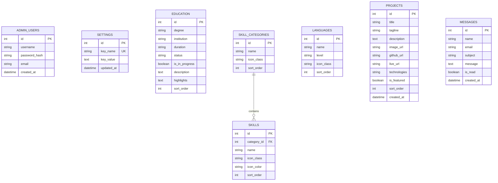

<div align="center">

# 🌟 Malik Raheem Bukhsh — Professional Portfolio & Dynamic CMS

**Full Stack Web Engineer & Professional Android App Developer**  
*Building modern, scalable web solutions, native mobile apps, and automated SaaS platforms.*

[](https://php.net)
[](https://mysql.com)
[](https://developer.mozilla.org/en-US/docs/Web/JavaScript)
[](https://developer.mozilla.org/en-US/docs/Web/CSS)
[](https://developer.mozilla.org/en-US/docs/Web/HTML)
[](LICENSE)

[🌐 View Live Showcase](https://socialmate.iamraheem.com) • [📬 Contact Malik](mailto:malik2341971@gmail.com) • [💬 Chat on WhatsApp](https://wa.me/923042341971)

</div>

---

## 📌 Table of Contents

- [Overview](#-overview)
- [Key Features](#-key-features)
- [Featured Projects](#-featured-projects)
- [Tech Stack & Architecture](#-tech-stack--architecture)
- [Database Architecture](#-database-architecture)
- [Private Admin Management Portal](#-private-admin-management-portal)
- [Installation & Local Setup](#-installation--local-setup)
- [Project Directory Structure](#-project-directory-structure)
- [Security & Best Practices](#-security--best-practices)
- [Author & Connect](#-author--connect)

---

## 🚀 Overview

This repository houses the personal developer portfolio and content management system of **Malik Raheem Bukhsh**, a motivated Web and Android App Developer pursuing BS Software Engineering at *The Islamia University of Bahawalpur (IUB)*.

The portfolio is engineered with a custom PHP dynamic backend, relational MySQL database architecture, and a secured administrator panel. It includes bidirectional scroll reveal animations, dynamic theme toggling (dark & light modes), an interactive contact form with instant human-verification, and an administrative dashboard to manage profile settings, academic qualifications, technical skills, languages, projects, and incoming contact inquiries.

---

## ✨ Key Features

- **🎨 Modern Responsive UI / UX**:
  - Custom cursor follower animations.
  - Glowing aura rotating rings around the hero profile image.
  - Theme switcher with smooth CSS variable transitions (Dark / Light mode).
  - Clean, mobile-first navigation drawer with backdrop filter.
  - Interactive circular SVG scroll progress indicator with "Back to Top" trigger.

- **⚡ Bidirectional Scroll Reveal Animations**:
  - Smooth fly-in animations (`reveal-up`, `reveal-down`, `reveal-left`, `reveal-right`) driven by a high-performance `IntersectionObserver`.
  - Re-triggers seamlessly on both scrolling down and scrolling up.

- **🗄️ Fully Dynamic MySQL Backend**:
  - Auto-initializes database tables (`settings`, `education`, `skill_categories`, `skills`, `languages`, `projects`, `messages`, `admin_users`) on first connection without manual SQL import required.
  - Fallback relational schema file included in `database/schema.sql`.

- **🛡️ Secret-Gated Private Admin Portal**:
  - Hidden from the public website (no visible lock buttons or portal links in navbar, menu, or footer).
  - Protected with a secret query token (`?key=raheem2026`) that redirects unauthenticated public visitors back to the homepage.
  - Full CRUD operations for portfolio projects, skills, education, languages, and profile bio.
  - Real-time contact inbox with read/unread statuses and message deletion.

- **📬 Contact & Lead Generation**:
  - Anti-spam human verification math challenge.
  - Asynchronous AJAX form dispatch with instant feedback alerts.
  - Message logging into the MySQL database with unread count notifications in the admin dashboard.

---

## 💼 Featured Projects

### 1. [SocialMate – WhatsApp Bot SaaS Dashboard](https://socialmate.iamraheem.com)
- **Tagline**: WhatsApp Automation & Marketing SaaS Platform
- **Stack**: `Blade`, `PHP`, `Laravel`, `CSS`, `JavaScript`
- **Description**: A modern WhatsApp automation platform helping businesses connect multiple WhatsApp numbers, automate replies, organize contact groups, design message templates, broadcast campaigns, manage API gateways, configure anti-ban safeguards, and manage recurring subscription plans.
- **Repositories**: [GitHub Source Code](https://github.com/mraheem971/auto-whatsapp.git) • [Live Platform](https://socialmate.iamraheem.com)

### 2. CampusMate – University Student & Attendance App
- **Tagline**: Native Android Mobile Application
- **Stack**: `Android Studio`, `Java`, `Firebase`, `SQLite`, `Material UI`
- **Description**: An intuitive Android mobile application for university students to track lecture attendance percentages, daily schedules, CGPA metrics, exam eligibility statuses, and real-time department announcements with offline caching and cloud synchronization.
- **Repository**: [GitHub Source Code](https://github.com/mraheem971)

---

## 🛠️ Tech Stack & Architecture

| Tier | Technologies |
| :--- | :--- |
| **Frontend** | HTML5, CSS3 (Custom Design System, Flexbox, CSS Grid), JavaScript (ES6+ Vanilla, IntersectionObserver API, Async/Await Fetch) |
| **Backend** | PHP 8.0+ (Procedural + Functional OOP, Prepared PDO Statements, Session Security) |
| **Database** | MySQL 8.0+ (InnoDB, UTF8mb4 Unicode, Foreign Key Relationships, Cascading Deletes) |
| **Icons & Typography** | FontAwesome 6.4 (SVG & Web Fonts), Google Fonts (Poppins, Fira Code) |
| **Tools & Server** | Apache (XAMPP / WAMP), Git, Composer |

---

## 🗄️ Database Architecture

The relational schema is configured in [`database/schema.sql`](database/schema.sql) and auto-seeded by [`config/db.php`](config/db.php):



---

## 🔐 Private Admin Management Portal

To maintain privacy and prevent unauthorized access, all public links to the admin portal are removed from the frontend.

### Accessing the Portal
1. Open your browser and navigate to:
   ```
   http://localhost/my_portfolio/admin/login.php?key=raheem2026
   ```
2. **Default Credentials**:
   - **Username**: `admin`
   - **Password**: `admin123` *(changeable anytime in Profile Settings)*
3. **Admin Modules**:
   - **Dashboard**: Live counter widgets, unread notifications, quick navigation.
   - **Profile & Bio**: Edit greetings, bio paragraphs, contact details, and social links.
   - **Education**: Add, modify, or reorder degree qualifications and certifications.
   - **Skills & Tech**: Manage skill categories and individual technical tags with custom colors.
   - **Projects**: Add new showcase items, upload screenshot banners, toggle featured status, and edit repository URLs.
   - **Languages**: Update language proficiency cards.
   - **Inquiries Inbox**: Read, filter, and delete messages sent from the contact form.

---

## 💻 Installation & Local Setup

### Prerequisites
- [XAMPP](https://www.apachefriends.org/) (Apache + MySQL + PHP 8.0+) OR standalone PHP & MySQL server.
- [Git](https://git-scm.com/) installed on your machine.

### Step-by-Step Installation

1. **Clone the repository**:
   ```bash
   git clone https://github.com/mraheem971/my_portfolio.git
   cd my_portfolio
   ```

2. **Move to Web Server Root**:
   - For XAMPP (Windows): Copy the directory to `C:/xampp/htdocs/my_portfolio`

3. **Database Configuration**:
   - Open MySQL in XAMPP / terminal.
   - The application **auto-creates** the database `my_portfolio` and tables on first load!
   - *(Optional Manual Setup)*: Import `database/schema.sql` into your MySQL client.
   - Database credentials can be customized in [`config/db.php`](config/db.php):
     ```php
     define('DB_HOST', 'localhost');
     define('DB_PORT', '3306');
     define('DB_NAME', 'my_portfolio');
     define('DB_USER', 'root');
     define('DB_PASS', '');
     ```

4. **Launch the Application**:
   - Open `http://localhost/my_portfolio/index.php` in your browser.
   - Alternatively, start a PHP development server:
     ```bash
     php -S localhost:8000
     ```
     and navigate to `http://localhost:8000/index.php`.

---

## 📂 Project Directory Structure

```plaintext
my_portfolio/
├── admin/                     # Secured Administrative Portal
│   ├── admin.css              # Dark-mode dashboard stylesheet
│   ├── education.php          # Education CRUD module
│   ├── footer.php             # Admin layout footer
│   ├── header.php             # Admin layout header with sidebar
│   ├── index.php              # Dashboard analytics & statistics
│   ├── languages.php          # Languages CRUD module
│   ├── login.php              # Secret-gated authentication screen
│   ├── logout.php             # Session destruction & exit
│   ├── messages.php           # Inquiries inbox module
│   ├── profile.php            # Bio & account password settings
│   ├── projects.php           # Projects showcase management
│   └── skills.php             # Skills & categories CRUD module
├── api/                       # Backend API Endpoints
│   └── contact.php            # AJAX contact handler with validation
├── assets/                    # Media & Static Visual Assets
│   ├── campusmate.png         # CampusMate Android project screenshot
│   ├── profile.jpg            # Hero & About profile photo
│   └── socialmate.png         # SocialMate WhatsApp SaaS screenshot
├── config/                    # Configuration Files
│   └── db.php                 # MySQL PDO connection & auto-migration
├── database/                  # SQL Definitions
│   └── schema.sql             # Relational MySQL schema & seed data
├── includes/                  # Core System Functions & Helpers
│   ├── auth.php               # Session security & secret key gate
│   └── functions.php          # Data retrieval & business logic
├── .gitignore                 # Version control exclusions
├── index.html                 # Standalone static template
├── index.php                  # Primary dynamic portfolio page
├── README.md                  # Project documentation & guide
├── script.js                  # Frontend interactions & animations
└── style.css                  # Custom styling & responsive layouts
```

---

## 🔒 Security & Best Practices

- **PDO Prepared Statements**: 100% parameterization prevents SQL Injection vulnerabilities across all queries.
- **XSS Sanitization**: Input sanitized via `htmlspecialchars()` using UTF-8 encoding.
- **Bcrypt Password Hashing**: Passwords stored using `password_hash()` with `PASSWORD_DEFAULT`.
- **CSRF Token Generation**: Session-bound tokens for form submissions.
- **Honeypot & Human Math Verification**: Anti-bot challenge on the contact endpoint.
- **Admin Access Obfuscation**: Direct requests to `/admin/` are automatically terminated and redirected unless unlocked with the secret passkey.

---

## 👨‍💻 Author & Connect

**Malik Raheem Bukhsh**  
*Web & Android App Developer from Bahawalpur, Pakistan*

- 🌐 **Portfolio**: [https://socialmate.iamraheem.com](https://socialmate.iamraheem.com)
- 💬 **WhatsApp**: [+92 304 2341971](https://wa.me/923042341971)
- ✉️ **Email**: [malik2341971@gmail.com](mailto:malik2341971@gmail.com)
- 📸 **Instagram**: [@malikraheem4113](https://instagram.com/malikraheem4113)
- 🐙 **GitHub**: [@mraheem971](https://github.com/mraheem971)

---

<div align="center">
  <sub>Crafted with dedication & passion by Malik Raheem Bukhsh &bull; &copy; 2026 All Rights Reserved</sub>
</div>
